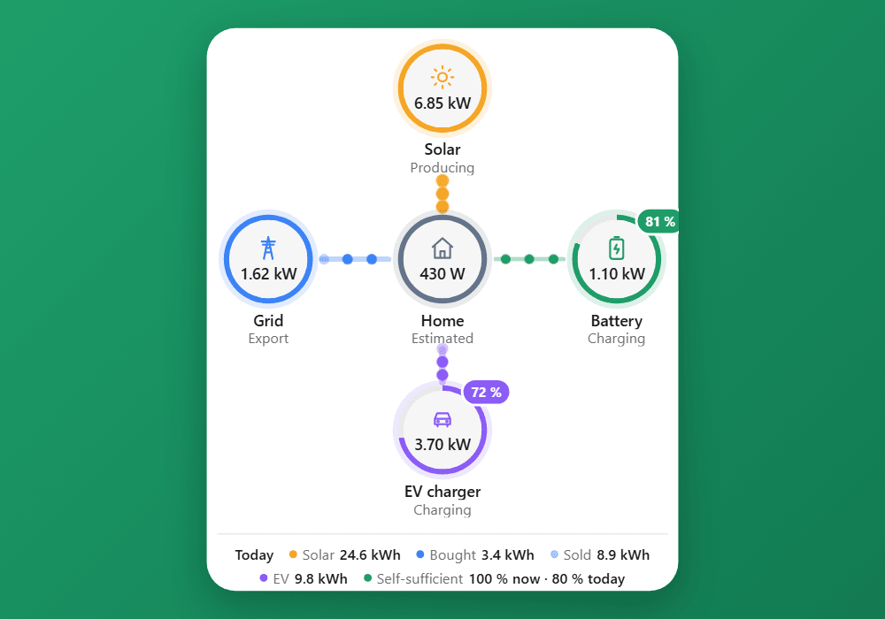
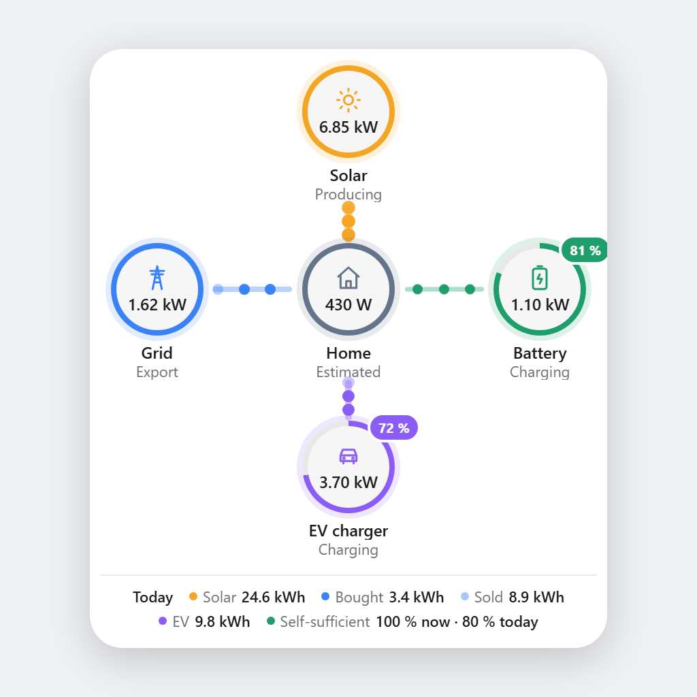
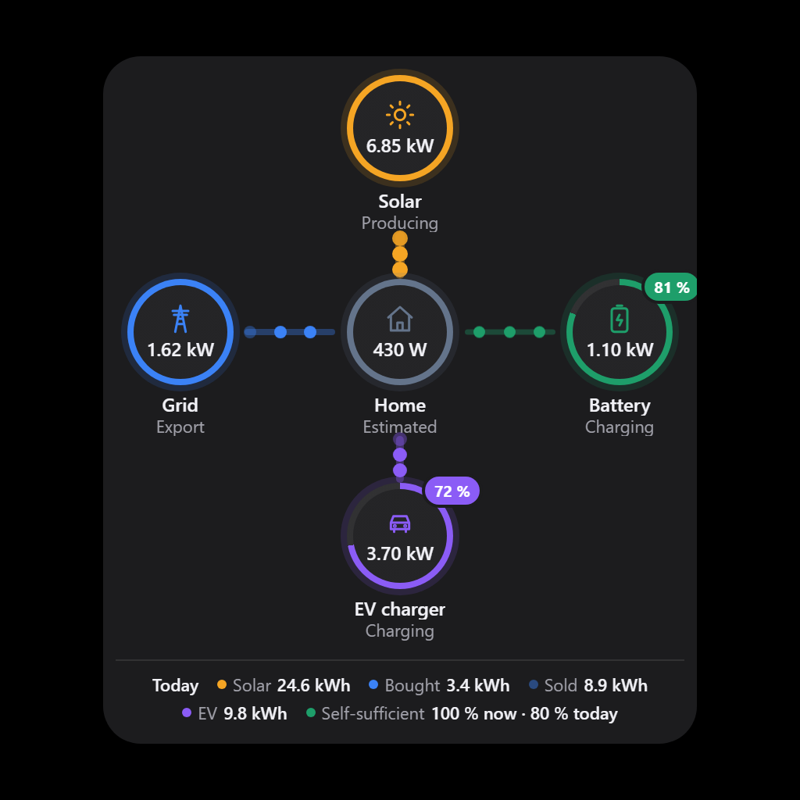

# HousePulse for Homey

See how electricity flows through your home, live on your Homey dashboard: grid, solar, EV charger and home battery around your home's consumption, with the state of charge of your battery and car, today's kWh totals and how self-sufficient you are.

**App ID:** `io.github.marlark.housepulse` · **SDK:** Homey Apps SDK v3 · **Homey:** Homey Pro, firmware ≥ 12.1.0 · **License:** MIT · **Languages:** English, Svenska, Norsk, Dansk, Deutsch, Nederlands

---

## Contents

- [What is HousePulse?](#what-is-housepulse)
- [Requirements](#requirements)
- [Getting started](#getting-started)
- [The Energy Flow widget](#the-energy-flow-widget)
- [Widget settings](#widget-settings)
- [Which devices work](#which-devices-work)
- [Automatic device suggestions](#automatic-device-suggestions)
- [Today's totals](#todays-totals)
- [How data is kept up to date](#how-data-is-kept-up-to-date)
- [Waiting for other apps at startup](#waiting-for-other-apps-at-startup)
- [Diagnostics](#diagnostics)
- [Privacy and permissions](#privacy-and-permissions)
- [Good to know](#good-to-know)
- [Troubleshooting](#troubleshooting)
- [Development](#development)
- [Translations](#translations)
- [Disclaimer](#disclaimer)
- [License](#license)

## What is HousePulse?

HousePulse adds an **Energy Flow** widget to Homey's dashboards. It shows where your electricity comes from and where it goes, right now: from the grid and your solar panels, to your home, your EV charger and your home battery.

HousePulse doesn't connect to any hardware or cloud service itself. It reads the values of energy devices you already have in Homey (electricity meters, inverters, batteries, chargers and cars from any brand) and brings them together in one view.

## Requirements

- Homey Pro with firmware 12.1.0 or later (needed for dashboard widgets)
- At least one energy device in Homey that reports power (`measure_power`), for example an electricity meter (P1/HAN), a solar inverter, an EV charger or a home battery
- Optional: an electric car in Homey that reports its battery level (`measure_battery`)

## Getting started

1. **Install HousePulse** on your Homey.
2. **Add the widget.** Open a dashboard, edit it and add **Energy Flow** from HousePulse.
3. **Done.** The widget picks your energy devices automatically and shows them right away. To use other devices, edit the widget and choose them in the settings. Pick **— None —** to remove a device.

Today's totals start counting from the moment the widget first shows a device. From the next day on they cover the whole day.

## The Energy Flow widget

The widget shows five nodes: **Solar** at the top, **Grid** on the left, **Home** in the centre, **Home battery** on the right and **EV charger** at the bottom. Optionally a sixth, bottom right: an **extra consumer** of your choice, such as a heat pump, sauna or pool, connected to Home with a diagonal line.

- **Live power** for every node, in W or kW.
- **Flow lines** between the nodes and Home. Moving dots show the direction (import or export, charging or discharging); they move faster and the line gets thicker as the power increases.
- **State of charge** as a ring around the home battery and around the EV charger (the car's battery level), with a % badge. The ring turns red below 20 %.
- **Home consumption** in the centre: measured by a meter of your choice, or calculated from the other devices (marked *Estimated*). With an extra consumer, Home shows the rest of the house.
- **Today:** solar production, energy bought and sold, EV charging and home battery charging with the share that came from solar, the extra consumer (kWh), self-sufficiency and solar self-consumption, right now and for today.
- **Status per node:** *Import / Export*, *Producing*, *Charging / Discharging*, *Consuming*, *Idle*, *Offline*, *Device not found*, or *Last 14:02* when a value hasn't been updated for a while.
- **Light and dark mode** follow the dashboard, and the widget adapts its height to its content.

| Light | Dark |
|---|---|
|  |  |

### Self-sufficiency and self-consumption

Two different questions: **self-sufficiency** is how much of what you used did not come from the grid; **self-consumption** (Solar self-use) is how much of the solar you produced you used yourself instead of selling it.

| Figure | How it is calculated |
|---|---|
| Self-sufficiency now | Share of the current consumption (home + EV charging + battery charging) not covered by grid import |
| Self-sufficiency today | 1 − bought ÷ today's consumption, where consumption = bought + solar − sold + battery discharged − battery charged |
| Self-consumption now | 1 − current export ÷ current solar production |
| Self-consumption today | 1 − sold ÷ today's solar production |

### Charged from solar

The EV and battery items show how much of today's charging came from your solar panels, for example *EV 12.4 kWh · 68 % solar*.

At every moment, the power flowing into the house comes from solar, grid import and battery discharge, and every consumer gets the same mix. So when you export, all charging is solar; when you import 2 kW while the panels give 3 kW, 60 % is solar. The app adds this up all day, also while no dashboard is open, and starts over at midnight.

It needs grid, solar, and an EV charger or a home battery. Energy the battery discharges counts as *not* solar, even if it was charged from solar earlier, so for an EV charged from a home battery the figure is a lower bound.

## Widget settings

| Setting | Notes |
|---|---|
| Grid meter | Your electricity meter, or the grid value of a hybrid inverter. Positive = import, negative = export. |
| Invert grid sign | For meters that report export as positive. Off by default. |
| Solar inverter, Solar inverter 2 | Power and today's production of two inverters are added up. |
| EV charger, EV charger 2 | Power of two chargers is added up. |
| Car (battery %) | Shown on the EV charger. Without a car, the charger's own battery level is used if it has one. |
| Home battery, Home battery 2 | Power is added up; the state of charge is averaged. Positive power = charging. |
| Invert battery sign | For batteries that report discharging as positive. Off by default. |
| Home consumption meter | Optional. Without it, consumption is calculated: grid + solar − battery charging − EV charging. |
| Extra consumer | Optional. A big consumer shown as its own node, e.g. a heat pump, sauna or pool. Heating devices are listed first. |
| Type of extra consumer | Heat pump (default), sauna, pool or other: sets the icon and the default name |
| Name of the extra consumer | Optional. Empty = the type is used as the name. |
| Mark values as old after | 5, 10 (default) or 30 minutes, or never |
| Show today's totals (kWh) | On by default |

Every device picker starts with **— None —**, to remove a device from the widget (Homey can't empty a picker otherwise).

## Which devices work

HousePulse doesn't depend on a particular brand. It recognises devices through what Homey itself standardises:

| Homey information | Used for |
|---|---|
| Energy settings of the driver (`energyObj`): whole-home meter, generator, home battery, EV charger, electric car | Suggesting devices for each role and choosing the right kWh meters |
| Device class (`solarpanel`, `battery`, `evcharger`, `car`) | The same, for drivers without energy settings |
| `measure_power` and its sub-values (e.g. `measure_power.solar`) | Live power |
| `measure_battery` | State of charge |
| `meter_power` and its sub-values (imported/exported, charged/discharged) | Today's kWh |

**Hybrid inverters and dongles** that report solar, grid and battery in one device are supported: the pickers list each power value of a device separately (e.g. *Inverter – Solar power*), so one device can fill several roles. For batteries there is also a *State of charge only* entry, for when the power comes from another device.

## Automatic device suggestions

A role you haven't touched in the settings is filled automatically. A role where you chose a device, or **— None —**, uses your choice. Choosing one device never removes the suggestions for the other roles.

| Role | Suggested device |
|---|---|
| Grid | A whole-home meter. With several candidates: the one matching Homey's own grid figure (within 5 % or 50 W), otherwise a meter with an export meter over a circuit meter, otherwise the largest load. Sockets, lights and appliances are never suggested. |
| Solar, Home battery, EV charger | Devices marked as generator, home battery or EV charger, or with that device class (up to two each) |
| Car | A device marked as electric car, or with the class *car* |
| Home, extra consumer | Never suggested: always your own choice |
| Fallback | A power sub-value with a matching name (e.g. `measure_power.solar`, `measure_power.grid`, `measure_power.battery`) |

While suggestions are used, the widget shows *Devices you have not chosen are picked automatically*.

## Today's totals

Today's kWh are counted by the app, per device and direction, and reset at midnight in Homey's time zone.

| Source | When |
|---|---|
| **The device's kWh meter** (exact) | The device has one: chosen from the driver's energy settings, otherwise from common names (`meter_power.imported`, `.exported`, `.charged`, `.discharged`, `meter_power`) |
| **Calculated from power** (marked ≈) | The device has no kWh meter for that direction, or a power sub-value is used. The last reported power is held until the next report. |

- **Midnight:** the meter reading at midnight is estimated between the last reading before and the first one after, so the day boundary is right even when a meter reports rarely.
- **Restarts:** totals and meter readings are saved, so today's figures continue after Homey or the app restarts. Time when the app wasn't running is covered by kWh meters, but not by calculated (≈) figures: gaps longer than 10 minutes are not guessed.
- **When no dashboard is open:** the app keeps counting for every device a widget has shown in the last 7 days.

## How data is kept up to date

| What | How |
|---|---|
| Live values | Pushed to the widget as soon as a device reports them, at most once per second per value (the newest value always arrives; today's kWh use every report) |
| Availability | Devices going offline, coming back or being deleted are shown right away |
| Widget refresh | Every minute the widget checks in with the app and gets a fresh snapshot |
| Old values | Re-evaluated every 30 seconds |
| Device list for pickers and suggestions | Cached for 30 seconds |
| Saved state | Every 5 minutes, and only when something changed |

The app only listens to the capabilities it needs from the devices your widgets show. A device you remove from a widget is released right away (today's total is kept until the end of the day, in case you add it back); devices no widget has asked for in 7 days are released as well.

On start, the widget tells Homey it is ready before talking to the app, so the dashboard never hangs on a spinner. While data loads, nodes show *…*. Calls to the app time out after 10 seconds, and suggestions are retried every 15 seconds.

## Waiting for other apps at startup

After a restart Homey starts all apps at the same time, so the apps that own your energy devices (inverter, meter, charger) may still be starting when HousePulse starts. Until they run, their devices report nothing or old values.

Under **Apps → HousePulse → Settings → Wait for apps at startup** you tick the apps to wait for. Only the apps that have devices in a widget (and apps you already ticked) are listed; **Choose the widget’s apps** ticks all of them at once. Other apps with energy devices, and all remaining apps (with search), are behind *Show more* links. At startup HousePulse checks every 5 seconds whether they are *running*, and only then starts listening to devices. Meanwhile the widget shows *Waiting for apps…* with their names.

- The wait runs in the background, so Homey never considers HousePulse hung during boot.
- Apps that are not installed or are disabled are skipped: they will never start.
- After at most 10 minutes HousePulse starts anyway, and the settings page shows which apps did not run.

## Diagnostics

Open **Apps → HousePulse → Settings** for a diagnostics report: how the app sees your energy devices (class, Homey energy settings, chosen kWh meters, driver), which devices the widgets use and their values, today's totals, the automatic suggestions, Homey's live energy figures, memory use and the most recent errors.

- **Hide device and zone names** is on by default, so the report can be shared as it is.
- **Copy report** copies it to the clipboard (or selects the text when copying isn't allowed).
- The page follows your device's light or dark mode.

Include this report when you ask about a device that isn't recognised or shows wrong values.

## Privacy and permissions

HousePulse needs the `homey:manager:api` permission, because the values it shows belong to devices of other apps. It uses it to **read** devices, zones and Homey's live energy report.

- It never controls devices or changes anything in Homey.
- It makes no network requests: all data stays on your Homey.
- It stores only which devices the widgets use and today's totals.

The full justification for Athom's review is in [`docs/PERMISSIONS.md`](docs/PERMISSIONS.md).

## Good to know

- **Signs differ between brands.** HousePulse expects the grid to be positive when importing and the battery to be positive when charging. If the calculated consumption stays negative for 3 minutes, the widget shows a hint, and says which *Invert … sign* setting is most likely needed.
- **Calculated consumption needs a grid value.** Without a home consumption meter, Home is calculated from the grid meter and the other devices. When the grid value is missing or old, Home shows *—* rather than a wrong figure.
- **Old values.** A value that hasn't been updated within the chosen time is dimmed and shows *Last 14:02*. Values close to 0 W never count as old, so solar panels at night aren't marked.
- **≈ means calculated.** A total marked ≈ is calculated from power because the device has no kWh meter. Totals from a kWh meter are exact.
- **The extra consumer is part of Home.** It is fed from Home, so its power is subtracted and Home shows the rest of the house. This assumes your home consumption meter (if you use one) measures the whole house, including the extra consumer. Self-sufficiency always uses the whole consumption.
- **Two devices per role are added up.** Power and today's kWh are summed; the state of charge of two batteries is averaged.
- **Self-sufficiency today needs grid and solar.** Without a solar device, only the figure for right now is shown. Self-consumption needs both grid and solar, and is hidden while the solar panels produce nothing.
- **Self-consumption counts everything sold as solar.** If your home battery also sells to the grid, the figure is a little too low (never below 0 %).
- **Charged from solar is calculated from power.** It uses the live power of grid, solar, EV and battery, so it is an estimate even when the kWh totals come from meters. Devices that haven't reported for 30 minutes are left out.
- **Not a billing meter.** Figures come from your devices and may differ slightly from your electricity company's.

## Troubleshooting

| You see | What to do |
|---|---|
| *Looking for energy devices…* for a long time | The app or Homey is still starting. Suggestions are retried every 15 seconds. If it stays, choose devices in the widget settings. |
| *No devices selected* | No energy devices were found, or every role is set to *— None —*. Choose devices in the widget settings. |
| A device is missing from a picker | It doesn't report the needed value (`measure_power`, or `measure_battery` for the car). Check the diagnostics report for its capabilities. |
| The wrong grid meter was picked | Choose your meter under *Grid meter*. |
| *Consumption comes out negative…* | A sign is the wrong way round: use the setting the hint names. |
| *Last 14:02* on a node | The device hasn't reported a new value since then. Check the device in Homey. |
| *Offline* or *Device not found* | The device is unavailable or was deleted in Homey. Choose another device, or *— None —*. |
| Today's totals are marked ≈ | The device has no kWh meter; the figure is calculated from power. |

## Development

The app does not use Homey Compose: `app.json` is edited directly.

| What | Where |
|---|---|
| App manifest, widget settings and APIs | `app.json` |
| Device listeners, sources, live updates, saving, diagnostics | `app.js` |
| App API (diagnostics, apps to wait for) | `api.js` |
| Role recognition, kWh meter choice, picker entries, suggestions | `lib/EnergyRoles.js` |
| Today's kWh (meters, calculation, midnight) | `lib/EnergyLedger.js` |
| Charged from solar | `lib/SolarSplit.js` |
| Widget API (`/subscribe`, `/suggest`) | `widgets/energy_flow_dash/api.js` |
| Widget view and texts | `widgets/energy_flow_dash/public/index.html` |
| Widget calculations (no DOM, shared with the tests) | `widgets/energy_flow_dash/public/js/flow-logic.js` |
| Widget styling | `widgets/energy_flow_dash/public/css/style.css` |
| Waiting for other apps at startup | `lib/AppDependencies.js` |
| Settings page (apps to wait for, diagnostics) | `settings/index.html`, `settings/settings.js` |

`homey app run --remote` runs the app on your Homey, `homey app install` installs it permanently and `homey app validate --level publish` checks it before publishing.

**Tests:** `npm test` runs all tests in `test/` with Node's built-in test runner (Node 22 or later). They use a stand-in for the Homey runtime and devices (`test/helpers/fakeHomey.js`) and run the real widget in [jsdom](https://github.com/jsdom/jsdom), a development dependency that isn't packed into the app. They cover role recognition and suggestions, today's kWh including midnight and restarts, device listeners, releasing and live updates, saving, the widget's start-up, rendering and calculations, the diagnostics page, translations of the settings page and memory statistics in Homey's sandbox.

**Debug logging:** with `homey app run` (which sets `DEBUG=1`), the app logs, marked `[DEBUG]`:

- on start: every energy-relevant device with its class, Homey energy settings and chosen kWh meters, Homey's live energy figures and the automatic suggestion, and a self-check of the diagnostics report
- every widget subscription with its sources and their values, every source attached or released, and every live value
- every minute: widgets, watched devices, today's totals, counters and memory use

The widget then also shows a debug footer with its sources, events and warnings. An app installed with `homey app install` doesn't log or show any of this.

## Translations

All texts exist in English, Swedish, Norwegian, Danish, German and Dutch:

| Texts | Where |
|---|---|
| Widget | `STRINGS` in `widgets/energy_flow_dash/public/index.html` |
| Widget name, settings and hints | `app.json` |
| Device pickers (*— None —*, *State of charge only*) | `LABELS` in `app.js` |
| Diagnostics page | `locales/*.json` |
| App Store description | `README.txt` / `README.<lang>.txt` |
| Changelog | `.homeychangelog.json` |

When adding a text, add all six languages. `npm test` checks that every text of the diagnostics page exists in all six.

The Norwegian, Danish, German and Dutch translations are new; corrections from native speakers are very welcome.

## Disclaimer

This is an unofficial, community-made app. It is not developed, endorsed or supported by Athom, or by the makers of the devices it shows. Brand and product names are used only to describe compatibility.

The figures shown come from your own devices. Totals marked ≈ are calculated, and no figure in the app is meant for billing.

## License

[MIT](LICENSE)
